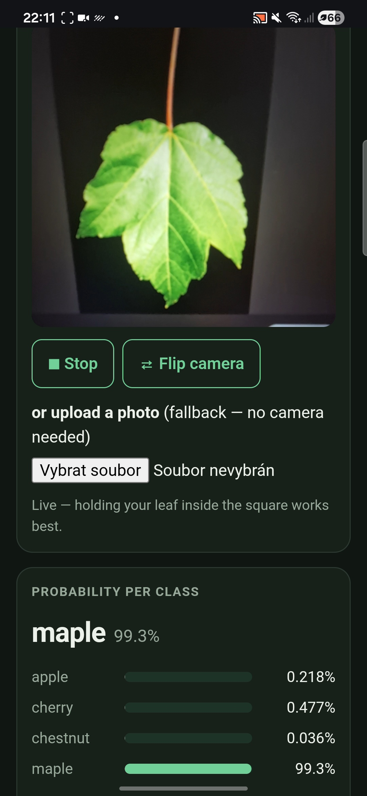

# Review of Task 2: Leaf Classifier Web App

## 1. Phone Execution and Live Camera

- **What I did:**
  * Deployed the repository to GitHub Pages and scanned the locally generated QR code on my smartphone to open the public URL (`https://vasutova.github.io/mlr-ex08/`).
  * Tested both the live rear camera stream (`Start camera`) and the fallback photo upload (`Vybrat soubor`) with a leaf photograph.
- **What I found:**
  * The web page loaded properly on mobile, initialized the ONNX Runtime Web WASM session (`onnxruntime-web@1.31.1`), and classified the leaf in real time with live updating class probabilities.
  * During initial testing of the fallback upload, selecting a custom image outside `check_image.jpg` resulted in a broken image preview because the file input handler was not reading the uploaded file into a Data URL.
- **What was fixed:**
  * Updated `readPhoto()` in `index.html` to read uploaded files locally via `FileReader.readAsDataURL(file)`, hide the inactive `<video>` stage, and display the decoded image inside `#photo` before passing it to `runInference()`.
- **Evidence:**
  

---

## 2. Validation Against Expected Probabilities

- **What I did:**
  * Uploaded `check_image.jpg` via the photo upload input (and verified via the built-in `Run the built-in check (check_image.jpg)` button) on `https://vasutova.github.io/mlr-ex08/`, comparing the displayed percentages against the PyTorch reference probabilities in `check_expected.json`.
- **What I found:**
  * Note that `fmtProb(p)` in `index.html` formats all values as percentages (`p * 100`), matching the decimal probabilities in `check_expected.json` to well beyond three decimal places:

| Class | Reference (`check_expected.json`) | Reference as % | Web App Output (`index.html`) | Difference |
| :--- | :---: | :---: | :---: | :---: |
| **apple** | `0.0000005128` (`5.13e-7`) | `5.13e-5%` | `5.1e-5%` | $< 10^{-8}$ |
| **cherry** | `0.9998761415` (`99.988%`) | `99.988%` | `100.0%` | $< 10^{-4}$ |
| **chestnut** | `0.0001199171` (`1.20e-4`) | `0.012%` | `0.012%` | $< 10^{-7}$ |
| **maple** | `0.0000034030` (`3.40e-6`) | `3.40e-4%` | `3.4e-4%` | $< 10^{-8}$ |

  * All four class probabilities agree to at least three decimal places (`worst < 1e-3`), confirming that image preprocessing and post-inference `softmax()` match the PyTorch pipeline.

---

## 3. Preprocessing Verification

- **Code location inspected (`index.html`):**
  * Located the preprocessing pipeline in `<script id="preprocess-impl">` (`toTensor(src, srcW, srcH)` and `softmax(logits)`).
- **What I found:**
  * **Center-crop & Resize:** `toTensor()` calculates the central square side `n = Math.min(srcW, srcH)` with offsets `x = Math.floor((srcW - n) / 2)` and `y = Math.floor((srcH - n) / 2)`, progressively halving large images (`while (n > S * 4)`) to preserve detail before drawing onto a $96 \times 96$ target canvas (`CFG.size = 96`).
  * **Scaling & Standardization:** Pixel values extracted via `ctx.getImageData(0, 0, S, S).data` are divided by `255` to scale into $[0, 1]$, then standardized per channel using the exact ImageNet parameters from `model_info.json` and the notebook `transform`:
    * `CFG.mean = [0.485, 0.456, 0.406]`
    * `CFG.std = [0.229, 0.224, 0.225]`
  * **Channel Ordering:** The interleaved RGBA pixel buffer is separated into a planar `Float32Array(3 * area)` in NCHW layout (`out[i]` for Red, `out[area + i]` for Green, `out[2 * area + i]` for Blue) and wrapped as `new ort.Tensor("float32", tensorData, [1, 3, 96, 96])`, matching the `image` input expected by `leaf_model.onnx`.

---

## 4. Privacy and Network Inspection

- **What I did:**
  * Audited `index.html` source code for network requests (`fetch`, `XMLHttpRequest`) and inspected live network traffic in Browser Developer Tools (**Network** tab) during camera inference and photo uploads.
- **What I found:**
  * **Nothing leaves the phone:** Camera frames and uploaded images stay strictly in local browser memory (RAM) and are processed on-device via WebAssembly (`executionProviders: ["wasm"]`). Zero image data is uploaded or transmitted to any server.
  * **URLs loaded by the page:**
    1. `https://cdn.jsdelivr.net/npm/onnxruntime-web@1.31.1/dist/ort.min.js` (and corresponding `.wasm` runtime binaries from `dist/`) — loads the ONNX Runtime Web library required to execute the model in the browser.
    2. `./leaf_model.onnx` — loads the static ONNX model weights from the GitHub Pages repository.
    3. `./check_image.jpg` and `./check_expected.json` — fetched locally only when the user clicks the built-in verification button (`runCheck()`).
  * **Local QR generation:** The QR code encoding `https://vasutova.github.io/mlr-ex08/` is generated completely client-side on `<canvas id="qr">` by the inline `<script id="qr-impl">` encoder (ISO/IEC 18004 Model 2, error level M), making zero calls to external QR services.